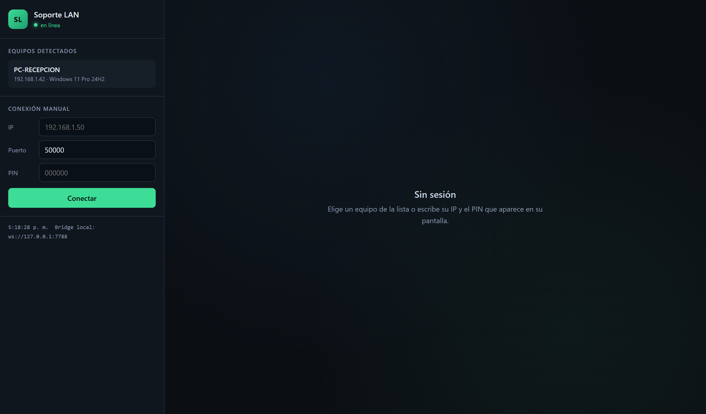
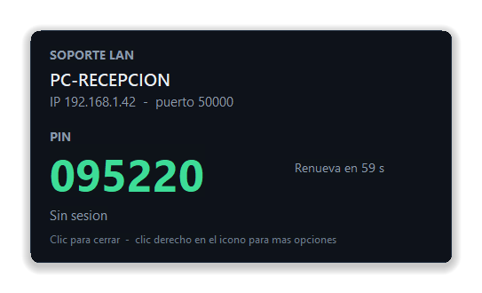

<div align="center">

# Soporte LAN

**Soporte remoto dentro de tu red local.** Sin nube, sin cuentas y sin instalar nada.

[](#requisitos)
[](#cómo-funciona)
[](#cómo-funciona)
[](#descargas)
[](LICENSE)

[**Descargar**](https://github.com/mgarciaz26/soporte-lan/releases/latest) ·
[Inicio rápido](#inicio-rápido-doble-clic) ·
[Seguridad](#seguridad) ·
[Desarrollo](#desarrollo)

</div>

<p align="center">
  
</p>

## Qué es

Una herramienta de acceso remoto para **red local**, pensada para soporte
interno en equipos Windows (ERP, ofimática, caja…). El técnico ve y controla la
pantalla del usuario sin pasar por Internet: no hay servidor central, ni cuenta,
ni suscripción.

- **Equipo atendido:** un único `soporte-agent.exe` de **11 MB**. Se ejecuta con
  doble clic, vive junto al reloj y no instala nada.
- **Técnico:** una web local que se abre con doble clic. El paquete ya incluye
  Node, así que no hay que instalar nada.
- **Autorización:** un **PIN de 6 dígitos** que solo se muestra en la pantalla
  del equipo atendido y cambia cada minuto.

## Características

| | |
|---|---|
| **Descubrimiento automático** | Los equipos aparecen solos en el visor (UDP broadcast). No hay que escribir IPs. |
| **TLS con pinning** | Certificado autofirmado y huella SHA-256 fijada. Sin CA ni configuración. |
| **PIN rotativo** | 6 dígitos, cambia cada 60 s y limita los intentos por IP. |
| **Todos los monitores** | Captura el escritorio virtual completo, incluidos varios monitores. |
| **Compresión sin pérdida** | Diff por tiles de 64×64 + zlib. El texto se ve perfecto, ideal para ERP. |
| **Ratón y teclado** | Control remoto real con `SendInput`, más cursor dibujado en el visor. |
| **Solo bandeja** | El agente no ocupa la barra de tareas ni abre consola. |
| **Cero dependencias** | El agente es self-contained; el visor lleva su propio `node.exe`. |

## Descargas

[](https://github.com/mgarciaz26/soporte-lan/releases/latest)

Los archivos se publican en **[Releases](https://github.com/mgarciaz26/soporte-lan/releases)**.
No hay instalador: se descarga, se descomprime (si aplica) y se hace doble clic.

| Archivo | Para quién | Tamaño | Contenido |
|---------|------------|--------|-----------|
| [`soporte-agent.exe`](https://github.com/mgarciaz26/soporte-lan/releases/latest/download/soporte-agent.exe) | Equipo atendido | 11,2 MB | Agente autónomo (self-contained). Un solo archivo. |
| [`SoporteLAN-Visor.zip`](https://github.com/mgarciaz26/soporte-lan/releases/latest/download/SoporteLAN-Visor.zip) | Técnico | 33,1 MB | Visor web + `node.exe` portátil + `Iniciar visor.vbs`. |

> **Windows SmartScreen:** el ejecutable no está firmado digitalmente, así que la
> primera vez puede avisar. Pulsa **Más información → Ejecutar de todas formas**.
> También puedes compilarlo tú mismo (ver [Desarrollo](#desarrollo)).

### Requisitos

- **Equipo atendido:** Windows 10 u 11, 64 bits. Nada más.
- **Técnico:** Windows y un navegador moderno (Edge, Chrome, Firefox).
- **Red:** ambos equipos en la misma LAN y el puerto **50000/TCP** accesible
  (el descubrimiento usa **47820/UDP**).

## Inicio rápido (doble clic)

### 1. En el equipo del usuario

Copia `soporte-agent.exe` y haz **doble clic**. Aparece el icono junto al reloj
y la tarjeta con el PIN, la IP y el estado.

> Si Windows 11 lo esconde en el panel `^`, arrastra el icono a la barra para
> dejarlo siempre visible.

### 2. En el equipo del técnico

Descomprime `SoporteLAN-Visor.zip` y haz **doble clic en `Iniciar visor.vbs`**.
Se abre el navegador en `http://127.0.0.1:7788` con la lista de equipos. El
bridge queda en segundo plano, sin ventana de consola, y se apaga solo a los
2 minutos de cerrar la pestaña.

### 3. Conectar

Elige el equipo de la lista (o escribe su IP y el puerto 50000), teclea el PIN
que aparece en la pantalla del usuario y pulsa **Conectar**. El teclado y el
ratón funcionan al hacer clic sobre la pantalla remota; **Pantalla completa**
amplía la sesión.

## Cómo funciona

```
   TÉCNICO                                        EQUIPO DEL USUARIO
┌──────────────────┐                            ┌──────────────────────┐
│ Visor web (TS)   │                            │ soporte-agent.exe    │
│  canvas + input  │                            │  ├ captura GDI       │
└────────┬─────────┘                            │  ├ tiles 64×64       │
         │ WebSocket local                      │  ├ SendInput         │
┌────────▼─────────┐        TCP + TLS          │  ├ PIN rotativo      │
│ bridge (Node)    │◄──────────────────────────►│  └ anuncio UDP       │
│  descubrimiento  │        puerto 50000        └──────────────────────┘
└──────────────────┘
         ▲
         │ UDP 47820 (broadcast, cada 5 s)
```

1. El agente anuncia por UDP su nombre, IP, puerto y la huella de su certificado.
2. El bridge lo lista en el visor. Al conectar, compara la huella con la
   anunciada: si no coincide, corta (protección contra suplantación).
3. El agente pide el PIN, lo valida y abre la sesión TLS.
4. Cada fotograma se divide en tiles de 64×64; solo se envían los que cambian,
   comprimidos con zlib y sin pérdida.

El protocolo completo está en [`docs/protocol.md`](docs/protocol.md).

## Puertos

| Puerto | Protocolo | Uso |
|--------|-----------|-----|
| 50000 | TCP | Sesión remota (TLS 1.2/1.3) |
| 47820 | UDP | Descubrimiento (broadcast, cada 5 s) |
| 7788 | TCP | Interfaz web + WebSocket del bridge (solo `127.0.0.1`) |

> Se eligieron así porque **AnyDesk ocupa UDP 50001 y TCP 7070**. Si chocan con
> otro software, cambia `--port` / `--discovery-port` en el agente y
> `BRIDGE_PORT` / `DISCOVERY_PORT` en el bridge.

## Bandeja del sistema

El agente es una aplicación de bandeja: **no ocupa espacio en la barra de
tareas** ni muestra consola.

<p align="center">
  
</p>

| Acción | Resultado |
|--------|-----------|
| Clic izquierdo | Tarjeta con PIN, IP, puerto y estado de la sesión |
| Clic derecho | Menú: **Mostrar PIN**, **Copiar PIN**, **Salir** |
| Pasar el ratón | Tooltip con el PIN actual |
| Clic en otro sitio | Cierra la tarjeta |

<details>
<summary><strong>Opciones de línea de comandos y arranque automático</strong></summary>

```powershell
soporte-agent.exe                  # doble clic: muestra la tarjeta y queda en la bandeja
soporte-agent.exe --quiet          # arranque silencioso (lo usa el autostart)
soporte-agent.exe --preview        # muestra la tarjeta del PIN al arrancar
soporte-agent.exe --console        # consola para desarrollo (logs en vivo)
soporte-agent.exe --pin 123456     # PIN fijo (pruebas)
```

Si ya está abierto, un segundo doble clic **no abre otra instancia**: muestra la
tarjeta con el PIN del agente que ya está corriendo.

Para que arranque al iniciar sesión (sin administrador y sin ventana):

```powershell
cd agent
.\scripts\install-autostart.ps1 -Start   # desinstalar: .\scripts\uninstall-autostart.ps1
```

Registro y datos:

- Log: `%LOCALAPPDATA%\SoporteLAN\agent.log` (rota a `.old` al pasar de 1 MB).
- Certificado: `%LOCALAPPDATA%\SoporteLAN\agent.pfx`.
- Solo se permite una instancia.

</details>

## Seguridad

- El PIN **es** el consentimiento en la v1: solo se muestra en la pantalla del
  equipo atendido y rota cada minuto.
- Máximo **6 intentos por minuto y por IP**.
- Canal **TLS 1.2/1.3** con certificado autofirmado y huella fijada; si alguien
  se hace pasar por el agente, el visor lo rechaza.
- El agente **no abre conexiones salientes** ni envía datos a Internet.
- Nada se escribe fuera de `%LOCALAPPDATA%\SoporteLAN`.

Pendiente para la v2: diálogo de aceptación explícita por sesión, registro de
sesiones en archivo, portapapeles, transferencia de archivos y selección de
monitor.

## Estructura

```
soporte-lan/
├─ agent/                  Agente Windows (.NET 9, sin dependencias)
│  ├─ Capture/             GDI + tiles + zlib
│  ├─ Input/               SendInput
│  ├─ Net/                 TLS, protocolo y servidor de sesión
│  ├─ Discovery/           Anuncio UDP
│  ├─ Security/            PIN rotativo
│  ├─ Tray/                Icono junto al reloj y tarjeta del PIN
│  └─ scripts/             Icono, publicación y autostart
├─ viewer/
│  ├─ bridge/              Node: UDP + TLS + WebSocket + interfaz estática
│  ├─ ui/                  Vite + TypeScript: canvas e input
│  └─ scripts/             Empaquetado y lanzador de doble clic
├─ tools/                  Clientes de prueba y capturas de documentación
└─ docs/                   Protocolo e imágenes del README
```

## Desarrollo

Solo para desarrollar hace falta **.NET 9 SDK** y **Node.js 20+**.

```powershell
# Agente -> agent\bin\Release\net9.0-windows\win-x64\publish\soporte-agent.exe
cd agent
.\scripts\publish.ps1

# Visor -> viewer\dist-visor\  (añade -Zip para SoporteLAN-Visor.zip)
cd viewer
npm install
.\scripts\empaquetar.ps1 -Zip

# UI con recarga en caliente (http://127.0.0.1:5173)
npm run dev
```

> Si instalas **Visual Studio Build Tools** (carga *Desktop development with
> C++*), puedes publicar el agente con NativeAOT y bajar de 11 MB a ~6 MB:
> `dotnet publish -c Release -r win-x64 -p:PublishAot=true -o publish-aot`

Pruebas sin navegador, con el agente en marcha:

```powershell
# Valida TLS, PIN y guarda un BMP de la pantalla remota
node tools/test-client.mjs 127.0.0.1:50000 123456 tools/frame.bmp

# Valida el bridge completo (descubrimiento + sesión + frame)
cd viewer/bridge
node test-viewer.mjs 127.0.0.1 50000 123456
```

## Limitaciones conocidas

- No funciona en la pantalla de login ni en UAC (modo asistido, sin servicio).
- Si el escritorio está bloqueado, GDI captura la pantalla de bloqueo sin
  contenido útil; hay que iniciar sesión.
- Solo red local: no hay retransmisión por Internet ni NAT traversal.
- Windows únicamente (el agente usa GDI y `SendInput`).

## Roadmap

- [x] Agente de bandeja con PIN rotativo y autostart
- [x] TLS con pinning y límite de intentos
- [x] Captura multi-monitor, ratón y teclado
- [x] Visor empaquetado con doble clic
- [ ] Aceptación explícita por sesión
- [ ] Transferencia de archivos y portapapeles
- [ ] Selección de monitor y calidad ajustable
- [ ] Registro de sesiones en archivo

## Licencia

[MIT](LICENSE) © 2026 mgarciaz26
